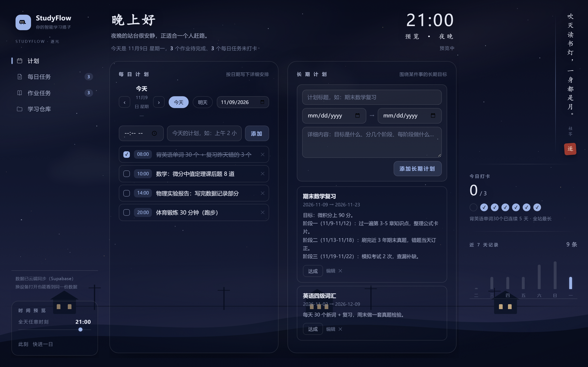
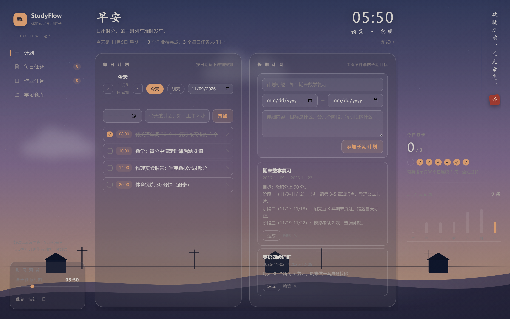
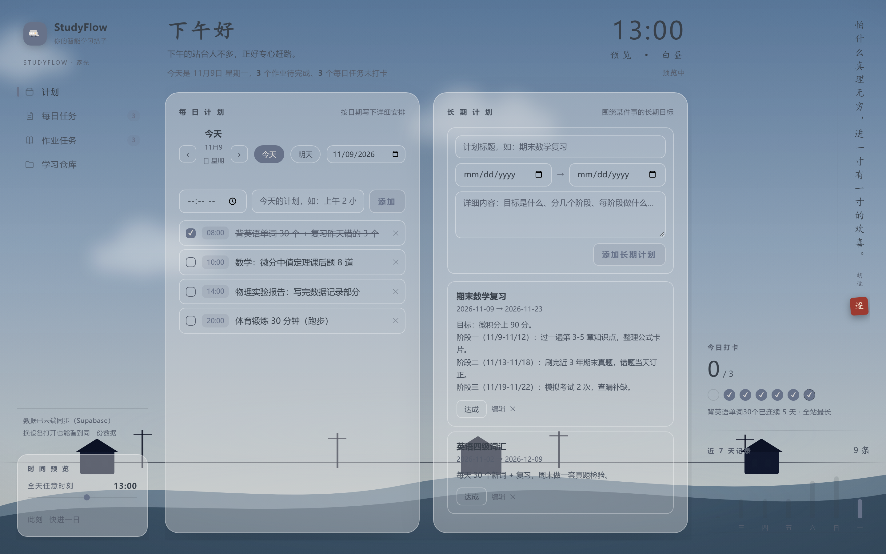
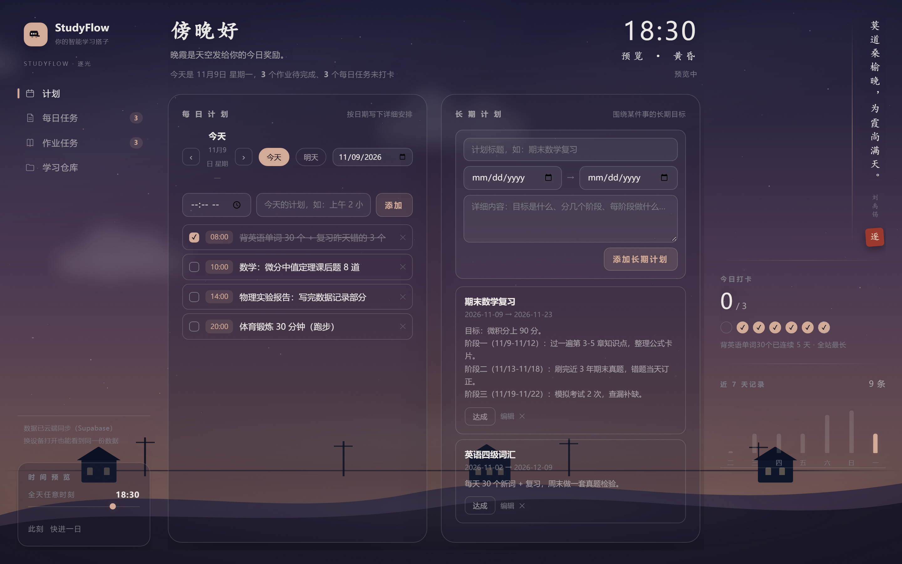

# StudyFlow 🎯

> 你的智能学习搭子 —— 校园黑客松参赛作品

一个帮学生管理学习计划的小网站：添加任务后自动识别重要程度（高/中/低），按紧急程度排序，并给出今日优先建议。v1.0 起换上「逐光」电影感主题——天空随真实时间流转，从夜晚星河到黄昏晚霞。



| 黎明 | 白昼 | 黄昏 |
|---|---|---|
|  |  |  |

## ✨ 功能

- **计划制定**：📅 每日计划——按日期写下详细安排（可带时段、完成勾选，今天/明天/任意天自由切换）；🎯 长期计划——围绕某件事的目标，标题+起止日期+阶段内容，可标记达成；制定/查看双模式分离，默认干净呈现
- **当日记录与反思**：每个日期的计划下方可写当日记录 + 今日反思，失焦自动保存，按日期留痕可回溯
- **任务分类**：🔁 每日任务（固定每天做，一次添加天天打卡）＋ 📝 作业任务（按截止日期管理），侧边栏各自独立成页
- **每日打卡（与任务同页）**：今天做没做都要记录——没做必填反思，完成也能写心得 + **自填用时**（分钟）；14 天日期记录表 + 连续打卡天数
- **任务附件**：作业内容（文本）、提交网址、文件（PDF 等）直接挂在任务上，云端存储随取随用
- **智能优先级识别**：根据截止日远近 + 任务关键词（考试/论文/作业等）自动标注 高/中/低 优先级，录入时实时预览
- **今日优先建议**：自动挑出最该先做的任务
- **学习仓库**：上传存放笔记文件（PDF / Markdown / 错题照片等），支持单文件与**整个文件夹**拖拽上传（保留目录结构）、科目分类、搜索、在线预览与下载
- **云端同步**：任务与文件实时同步 Supabase 云端，清缓存、换设备数据不丢；本地优先策略，断网也能正常用
- **逐光电影感主题**：7 关键帧调色板随真实时间连续插值，日出日落、星月列车皆在背景中运转；左下角可拖动预览全天任意时刻、快进一日
- **右侧陪伴栏**：随时段轮换的竖排诗句与朱红印章，安静陪伴不打扰

## 🛠 技术栈

- Next.js 16（App Router + Turbopack + Cache Components）
- React 19 + TypeScript
- Tailwind CSS 4
- Supabase（PostgreSQL + Storage，云端持久化）

## 🚀 本地运行

```bash
npm install
# 配置云端后端（可选，不配置则退化为纯本地模式）：
# 1. 在 Supabase 控制台 SQL Editor 执行 docs/supabase-setup.sql
# 2. 新建 .env.local，填入：
#    NEXT_PUBLIC_SUPABASE_URL=你的项目URL
#    NEXT_PUBLIC_SUPABASE_ANON_KEY=你的anon key
npm run dev
```

打开 http://localhost:3000

## 📖 开发日志

完整迭代过程（v0.1 → v1.0，含每版截图与改动说明）见 [docs/DEVLOG.md](docs/DEVLOG.md)。

```bash
# 回看任意历史版本
git checkout v0.1   # MVP 初版（含番茄钟）
git checkout v0.2   # 智能优先级
git checkout v0.3   # 截止时间精确到分
git checkout v0.4   # 侧边栏仪表盘
git checkout v0.5   # 学习仓库-笔记模块
git checkout v0.6   # 学习仓库重做为文件仓库
git checkout v0.7   # 接入 Supabase 云端后端
git checkout v0.8   # 任务分类 + 打卡反馈 + 任务附件
git checkout v0.9   # 计划汇总专栏（已被 v0.10 取代）
git checkout v0.10  # 计划页：每日详细计划 + 长期计划
git checkout v1.0   # 电影感换肤：逐光主题
git checkout v1.1   # 右栏精简：只留诗句与印章
git checkout v1.2   # 计划页制定/查看双模式 + 当日记录与反思（当前）
npm run dev
```
