# StudyFlow 开发日志

> 校园黑客松作品 —— 智能学习辅助网站
> 记录每一次改动的动机、内容与思考。每个版本对应一个 git tag，可随时 `git checkout v0.x` 回看。

## 版本总览

| 版本 | 主题 | 截图 |
|------|------|------|
| v0.1 | MVP 初版：学习计划 + 番茄钟 + 专注统计 | [查看](screenshots/v0.1-mvp.png) |
| v0.2 | 移除番茄钟，新增智能优先级识别 | [查看](screenshots/v0.2-priority.png) |
| v0.3 | 移除预计工作量，截止时间精确到分 | [查看](screenshots/v0.3-deadline-time.png) |
| v0.4 | UI 改版：侧边栏仪表盘 | [计划视图](screenshots/v0.4-dashboard-plan.png) · [统计视图](screenshots/v0.4-dashboard-stats.png) |
| v0.5 | 新增学习仓库（笔记模块） | [计划视图](screenshots/v0.5-plan.png) · [笔记视图](screenshots/v0.5-notes.png) |
| v0.6 | 学习仓库重做：改为文件仓库（上传/预览/下载） | [计划视图](screenshots/v0.6-plan.png) · [仓库视图](screenshots/v0.6-repo.png) |
| v0.7 | 接入 Supabase 云端后端（任务/文件云同步） | [计划视图](screenshots/v0.7-plan.png) · [仓库视图](screenshots/v0.7-repo.png) |
| v0.8 | 任务分类 + 打卡反馈 + 日期记录表 + 任务附件 + 反思/用时 | [每日任务（含打卡）](screenshots/v0.8-daily.png) · [作业任务](screenshots/v0.8-plan-homework.png) |
| v0.9 | 计划汇总专栏（一屏总览所有计划） | [计划汇总](screenshots/v0.9-plan.png) · [作业任务](screenshots/v0.9-homework.png) |
| v0.10 | 计划页重做：每日详细计划 + 长期计划 | [计划页](screenshots/v0.10-plan.png) |
| v1.0 | 电影感换肤：逐光场景层（调色板插值/天体轨道/列车）+ 右栏统计 | [夜晚](screenshots/v1.0-night.png) · [黎明](screenshots/v1.0-dawn.png) · [白昼](screenshots/v1.0-day.png) · [黄昏](screenshots/v1.0-dusk.png) |
| v1.1 | 右栏精简：去掉今日打卡与近 7 天记录，只留时段诗句与印章 | [计划页](screenshots/v1.1-plan.png) |
| v1.2 | 计划页分制定/查看双模式；每日计划按日期绑定当日记录与反思 | [查看模式](screenshots/v1.2-plan.png) · [制定模式](screenshots/v1.2-plan-edit.png) |
| v1.3 | 计划卡片内部滚动（主列固定不滚）+ 反思表单可收起 + 卡片可折叠 | [计划页](screenshots/v1.3-plan.png) · [每日任务](screenshots/v1.3-daily.png) |
| v1.4 | 今日任务=打卡任务+计划任务；今日描述计划日志；长期计划达成反思；我的足迹专栏 | [计划页](screenshots/v1.4-plan.png) · [今日任务](screenshots/v1.4-today.png) · [我的足迹](screenshots/v1.4-footprint.png) |

---

## v0.1 — MVP 初版

**目标**：一个人参赛，先跑通最小闭环：定计划 → 专注执行 → 看数据反馈。

**功能**：
- 任务管理：标题 / 科目 / 预计番茄数 / 截止日期，完成打勾、删除、进度条
- 按「剩余天数 ÷ 剩余番茄数」计算紧急程度，智能排序 + 今日优先建议
- 番茄钟：25 分钟专注 + 5 分钟休息循环，环形进度动画，可关联任务
- 统计面板：今日专注时长、完成任务数、连续学习天数、近 7 天专注时长柱状图
- localStorage 本地持久化，无需后端


---

## v0.2 — 移除番茄钟，新增智能优先级识别

**动机**：番茄钟与任务计划耦合度低，且偏离"智能学习计划"的核心定位；评委更容易被"智能"打动，于是砍掉番茄钟，换上更有辨识度的功能——自动识别任务重要程度（低/中/高）。

**改动**：
- 删除番茄钟模块及专注数据模型
- 新增优先级引擎 `src/lib/priority.ts`：截止日远近 + 关键词（考试/论文/答辩等）+ 预计工作量，三信号加权打分
- 任务标注 高/中/低 优先级标签（红/黄/灰），列表按优先级 → 截止日排序
- 添加任务时实时预览识别结果
- 统计面板改为任务维度：待办数 / 完成率 / 24h 内截止 / 优先级分布 / 近 7 天完成任务数
- 旧 localStorage 数据自动迁移（normalize 函数兜底）


---

## v0.3 — 移除预计工作量，截止时间精确到分

**动机**：添加任务的表单字段太多会降低录入意愿；"预计几小时"对用户是负担。同时真实的截止日期常常有具体时刻（如"今晚 8 点交作业"）。

**改动**：
- 删除"预计小时数"输入框及数据字段
- 新增可选截止时刻（time 输入），不填则只显示到日
- 展示规则：填了时刻 → `3 天后截止 · 11月12日 14:30`；没填 → `3 天后截止 · 11月12日`
- 优先级识别相应简化为两信号（截止日 + 关键词）


---

## v0.4 — UI 改版：侧边栏仪表盘

**动机**：单页堆叠布局像"作业页面"，黑客松演示需要"完整产品"的第一印象。

**改动**：
- 新增左侧边栏：品牌区 + 导航（学习计划 / 数据统计）+ 待办数角标
- 动态页头：按时段问候 + 今日日期 + 待办任务播报
- 统计视图宽屏适配：优先级分布与趋势图左右并排
- 移动端降级为顶部品牌栏 + 胶囊标签切换

**Bug 修复（同版本内）**：开启 Cache Components 后，`new Date()` 在预渲染阶段执行会报错（`unstable value in Client Component`）。修复：当前时间的读取移到客户端水合（hydrated）之后再执行。


---

## v0.5 — 新增学习仓库（笔记模块）

**动机**：学习计划解决"做什么"，但学习过程中产生的笔记、知识点总结没地方放。"计划 + 仓库"构成完整的学习闭环。

**改动**：
- 新增「学习仓库」视图（侧边栏第三个入口 📚）
- 笔记增删改查：标题 / 科目分类 / 多行正文，输入即自动保存（无需手动点保存）
- 全文搜索（标题 / 正文 / 科目）+ 置顶 + 按更新时间倒序
- 双栏布局：左侧笔记列表（科目标签、更新时间），右侧编辑器（字数统计、置顶、删除）
- 数据模型新增 `Note`，localStorage 旧数据自动迁移兼容


---

## v0.6 — 学习仓库重做：改为文件仓库

**动机**：v0.5 上线后收到真实反馈——用户要的不是在网页里手写笔记，而是一个**仓库**：把自己已有的笔记文件（PDF、Markdown、错题照片等）存进去，随取随用。这是一次典型的"按用户反馈推翻重做"。

**改动**：
- 移除 v0.5 的网页笔记编辑器，学习仓库改为**文件仓库**
- 支持拖拽 / 点选上传任意文件（单个 ≤50MB），上传时可归入科目
- **支持上传整个文件夹**（拖拽或「选择文件夹」），保留目录结构展示，文件夹名自动作为科目
- 在线预览：图片、Markdown/纯文本、PDF；其他类型（Word 等）可下载后查看
- 文件列表：类型图标、目录路径、科目分类（点击可改）、大小、日期、搜索（含路径）、下载、删除
- 存储方案：文件内容（Blob）存 **IndexedDB**（localStorage 存不下大文件），元信息仍走 localStorage；v0.5 的 notes 旧数据自动忽略


---

## v0.7 — 接入 Supabase 云端后端

**动机**：v0.6 的文件存在浏览器 IndexedDB，清缓存/换设备就丢。黑客松演示可能换电脑，需要真正的"记忆"——云端持久化。

**改动**：
- 接入 **Supabase**（PostgreSQL + Storage）：任务和文件元数据存数据库表，文件内容存 Storage 存储桶
- 同步策略：**本地优先**——localStorage 秒开首屏，后台拉取云端数据（云端为准）；每次变更同时写本地和云端，断网也能用
- 首次接入自动迁移：本地旧数据（任务、v0.6 的文件）自动上传云端，用户无感
- 并发防护：云端写操作串行队列化（upsert 与 delete 交错会互相覆盖，开发期实测踩过这个坑）
- 降级设计：未配置 Supabase 环境变量时自动退化为纯本地模式
- 建表脚本沉淀为 [supabase-setup.sql](supabase-setup.sql)，一键复现后端

**架构**：

```
浏览器 React 状态
   ├─ localStorage（首屏缓存，秒开）
   └─ Supabase（云端真实来源）
        ├─ tasks / repo_files 表（元数据）
        └─ repo-files 存储桶（文件内容）
```


---

## v0.8 — 任务分类 + 打卡反馈 + 日期记录表 + 任务附件

**动机**：用户真实场景——有些任务是"每天固定要做"的（背单词、锻炼），不该每天重新添加；而作业类任务是按次布置的。并且"做与没做"都要留痕，没做的要写反思原因，才能真正复盘。另外收到作业时，题目内容、提交网址、附件文件应该跟着任务走，不用到处翻。

**改动**：
- **任务分类**：🔁 每日任务（一次添加天天生效，无需截止日期）＋ 📝 作业任务（按截止日期）
- **管理分栏（迭代）**：按用户反馈，两类任务在侧边栏彻底分开——「每日任务」「作业任务」各自独立页面，各有添加表单与列表，不再混在一栏
- **每日任务与打卡合并一栏（迭代）**：按用户反馈，每日任务的管理与打卡放进同一页面——上方添加/列表，中间「今日打卡」（一键 ✅完成 / ❌没做，反思+用时表单），下方 14 天日期记录表，连续打卡 🔥
- **移除作业反馈页（迭代）**：用户决定先下线，作业反思功能代码保留在 git 历史
- **任务附件**：任务上可挂三类附件——📝 作业内容（直接粘贴题目文本）、🔗 网址（一键打开）、📄 文件（传 Supabase Storage），任务行显示附件数角标
- **数据模型**：新增 `checkins` 表（task_id + date 唯一，status=done/missed，reason 反思）；tasks 表新增 `type`、`attachments`(jsonb) 列，旧数据自动迁移
- **完成也可写反思（迭代）**：按用户反馈，完成打卡/作业完成后同样能补记"完成情况/心得"备注；反思/备注/用时统一放进醒目的表单卡片，不再藏在小按钮里
- **用户自填用时（迭代）**：打卡记录新增"用时"字段（分钟，自填，带 15/30/45/60 快捷值），打卡行、日期表悬停、作业记录表均展示
- **移除数据统计页（迭代）**：用户决定先下线统计功能，后续重新设计；Sidebar 精简为 4 个入口（StatsPanel 代码仍在 git 历史中可找回）


---

## v0.9 — 计划汇总专栏

**动机**：功能分散在多个专栏后，缺一个"打开 App 第一眼"的总览页——今天的打卡怎么样了、哪份作业最急、有没有逾期，一屏说完。

**改动**：
- 新增「计划汇总」作为默认首页（侧边栏第一位）
- 顶部四指标：今日打卡 x/y、待完成作业数、逾期数（红色警示）、最长连续打卡 🔥
- 「每日任务·今天」清单：状态图标（✅/❌/⭕）+ 一键打卡/撤销
- 「作业任务·待完成」清单：按优先级+截止日排序，逾期红标、附件角标，勾选即完成；底部显示已完成数
- 每个分区都有"去管理 →"快速跳转到对应专栏

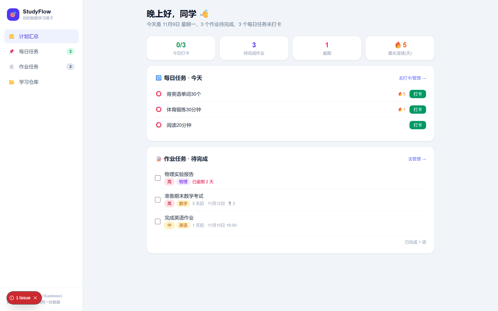

---

## v0.10 — 计划页重做：每日详细计划 + 长期计划

**动机**：v0.9 的"计划汇总"方向错了——用户要的不是数据看板，而是**能亲手写计划的页面**：今天的、明天的详细安排，以及围绕某件事的长期规划。（v0.9 汇总页已删除，这是一次明确的"按反馈推翻重做"）

**改动**：
- 「计划」专栏改为双区布局，两种计划类型同页分栏呈现：
  - **📅 每日计划**：日期自由切换（‹ › / 今天 / 明天 / 日期选择器），逐条添加安排（可选时段 HH:mm），按时间排序，完成勾选、删除
  - **🎯 长期计划**：标题 + 起止日期（可选）+ 详细内容（目标/阶段/步骤），卡片展示，支持编辑、标记"已达成"
- 新增 `plans` 表（type 区分 daily/longterm，起止日期、完成态、时间戳），云端同步
- 首页默认视图仍为「计划」

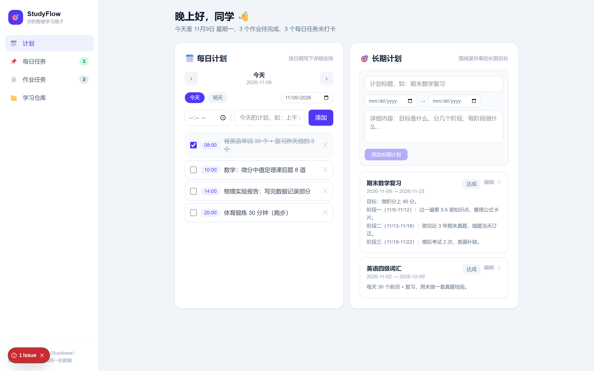

---

## v1.0 — 电影感换肤：逐光

**动机**：功能已齐，但界面是"能用"而非"想用"。按设计规格书（草稿 v5）一比一移植「逐光」电影感主题——只换皮肤，不动逻辑，`src/lib/` 数据层一行未改。

**改动**：
- **场景层 `Scene.tsx`**（z0，pointer-events:none，在 UI 之下）：天空三段渐变 / 银河 / 星星 / 光柱 / 日月 / 云 / 远山 / 列车 / 电线杆 / 亮窗房屋，全部 DOM+CSS 绘制，无图片资源
- **场景时钟 `useSceneClock.ts`**：7 关键帧调色板（夜→黎明前→黎明→清晨→白昼→黄昏→入夜）随真实时间连续插值，rAF 每帧直写 CSS 变量（不触发 React 重渲染）；太阳/月亮轨道公式、各时段诗句与问候语逐字照抄草稿
- **时间预览**：左下角悬浮卡可拖动预览全天任意时刻、一键"快进一日"（90 秒循环），时段徽标显示"预览 · 黄昏"等状态
- **右栏 `AsideStats.tsx`**：竖排时段诗句 + 朱红印章、今日打卡 x/y、近 7 天打卡点、最长连续打卡、近 7 天记录柱状图
- **全组件换皮**：玻璃拟态面板（半透明+backdrop-blur）、三列 grid 布局（侧栏/主区/右栏）、系统楷体点缀（问候语/诗句/徽标）、零 emoji（全部替换为 SVG 图标或文字）
- **修复**：`dailyUnchecked` 在 `useMemo` 中于预渲染阶段读取 `new Date()`（Cache Components 报错，dev overlay 持续显示 "1 Issue"），改为 hydrated 后再读

**四个时段**（调色板连续插值，非四套主题）：

| 黎明 05:50 | 白昼 13:00 |
|---|---|
| 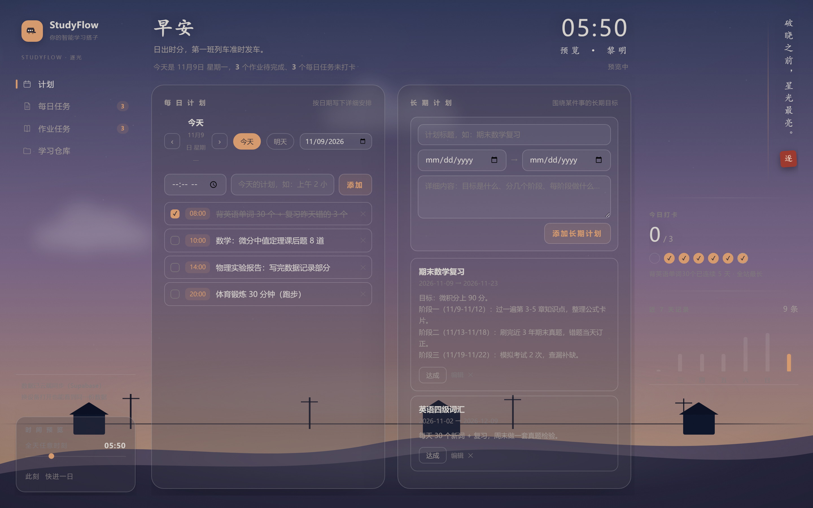 | 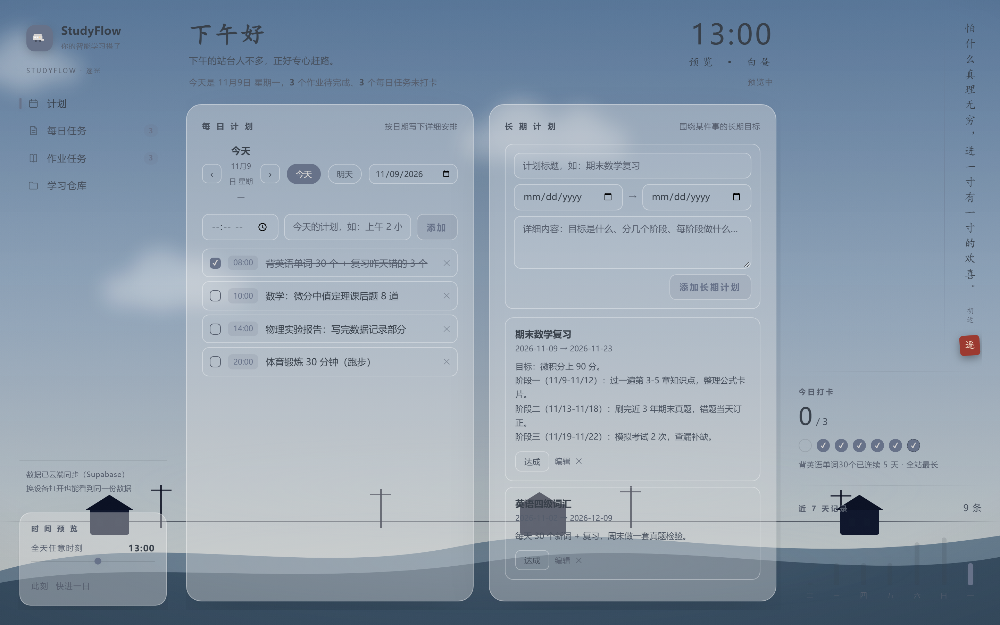 |

| 黄昏 18:30 | 夜晚 21:00 |
|---|---|
| 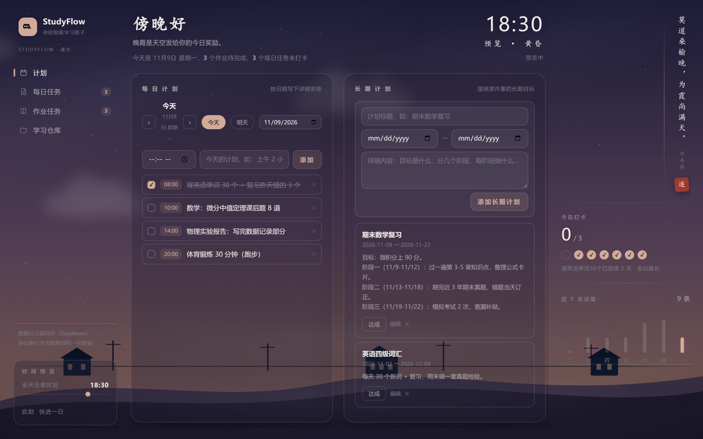 | 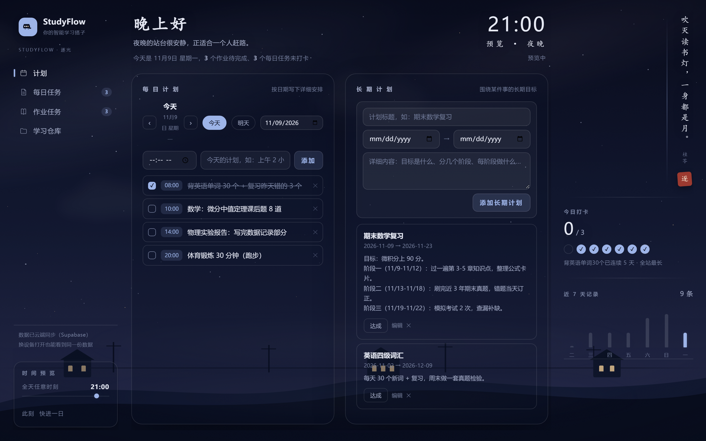 |

**各视图**：[计划页](screenshots/v1.0-plan.png) · [每日任务](screenshots/v1.0-daily.png) · [作业任务](screenshots/v1.0-homework.png) · [学习仓库](screenshots/v1.0-repo.png)

---

## v1.1 — 右栏精简

**动机**：右栏的"今日打卡""近 7 天记录"两块统计信息与主区功能重复（顶栏已有未打卡计数、任务页有完整打卡记录），撤掉后右栏只做一件事——安静陪伴。

**改动**：
- 移除右栏今日打卡（x/y + 周圆点 + 最长连续）与近 7 天记录柱状图，只保留竖排时段诗句 + 朱红印章
- `AsideStats.tsx` 更名 `AsideQuote.tsx`（职责已变，不再统计），props 从 tasks/checkins 精简为 phase
- 同步清理 globals.css 中这些模块独占的样式（stat/sdot/wk/bar 系列与 .hr，共 20 条规则）

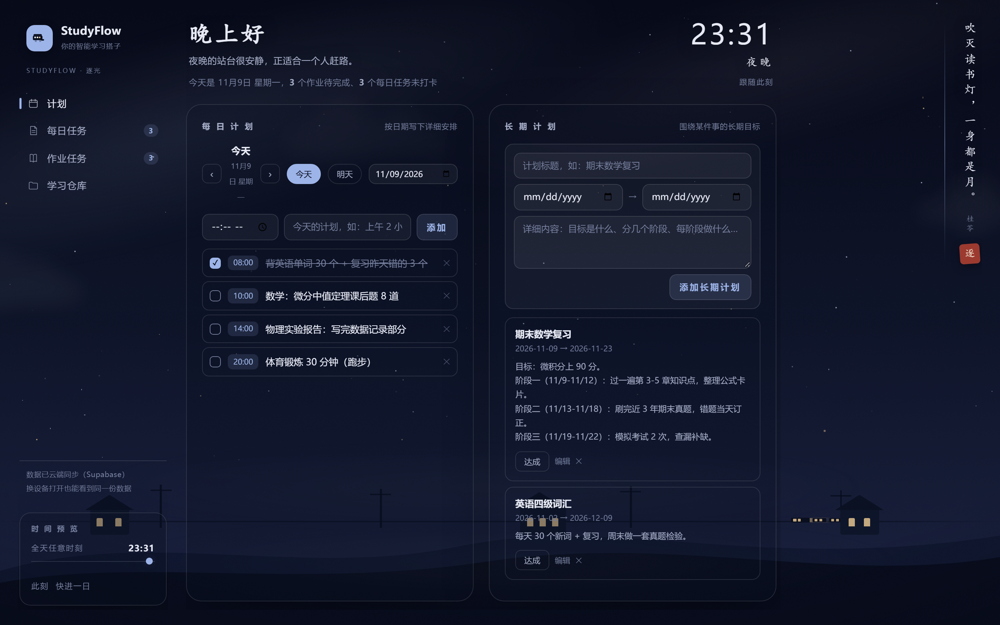

---

## v1.2 — 制定与查看分离 · 当日记录与反思

**动机**：计划页的"写计划"和"看计划"挤在同一界面，输入框永远占着视觉重心；而且每天执行完计划后，缺一个按日期复盘的地方。

**改动**：
- **制定/查看双模式**：每日计划卡片内新增「查看 / 制定」切换，默认查看模式——干净的计划呈现（可勾选完成），不摆输入框；切到「制定」才出现添加行与删除按钮。空日期显示「这一天还没有制定计划 → 去制定」引导
- **当日记录 + 今日反思**：查看模式下每个日期自带两栏书写区（新表 `day_notes`，与每日计划同日期键），失焦自动保存并显示保存时间；清空内容即删除该日记录；切换日期自动跟随
- **长期计划表单折叠**：默认只呈现计划卡片，点「+ 制定长期计划」才展开表单，添加/收起后自动收回
- **修复**：`DayNoteEditor` 草稿用 `useState` 初始化后不随外部更新（云端同步到达时会显示过期内容），补 `useEffect` 按 `note.updatedAt` 重置；首迁判空条件纳入 `dayNotes`
- **容错**：`day_notes` 是新增表，未重跑建表 SQL 时拉取/推送仅告警不中断（其余表同步不受影响）

**注意**：本版本需要**再跑一次 `docs/supabase-setup.sql`**（幂等，新增 `day_notes` 表与策略），否则记录与反思只保存在本地。

| 查看模式（默认） | 制定模式 |
|---|---|
| 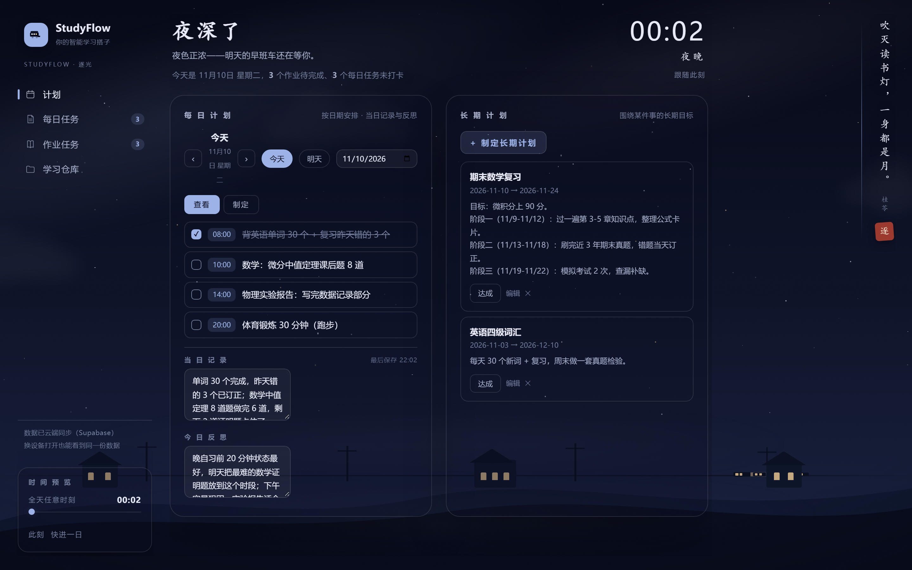 | 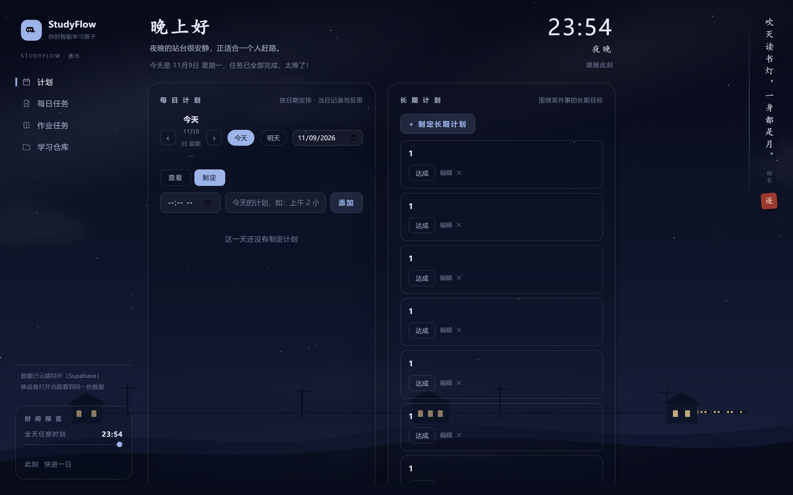 |

---

## v1.3 — 卡内滚动 · 表单可收起 · 卡片可折叠

**动机**：实际使用暴露三个交互问题——①计划一多，滚动的是整个主列，顶栏被顶走、两张卡内容错位；②打卡反思表单弹出后"合不上"：「跳过」按钮实际会直接保存完成记录，没有"只是收起不写"的出口；③每日任务视图三个区块摞起来太长，找内容要滚好几屏。

**改动**：
- **主列布局重构**：`.main` 不再滚动（顶栏固定常驻），滚动收敛到 `.views` 视图容器；计划页两张卡填满视图高度（`grid-template-rows: minmax(0,1fr)`），计划列表与记录反思区在 `.card-scroll` 内独立滚动，卡头/日期栏/模式切换固定不动。窄屏（<1330px）自动退回自然文档流
- **打卡表单可真正合上**：`ReflectionForm` 取消按钮统一为「收起」= 纯合上表单、不产生任何记录（此前完成场景的「跳过」会直接写入一条完成打卡，这就是"合不上"的根因）；「完成」「没做」按钮支持再点一次收起；快速打卡不写反思 = 直接点「保存完成」（反思本就选填），或仍可用任务列表前的一键勾选
- **三张卡可折叠**：新增通用组件 `CollapsibleCard`（标题栏右侧「收起/展开」按钮）——任务清单卡与今日打卡卡默认展开，14 天的日期记录表默认折叠，长视图一键瘦身；作业任务视图同样受益。附件面板模态移到折叠容器外，避免收起时被卸载

| 计划卡内滚动（10 条计划不撑长页面） | 每日任务（记录表默认折叠） |
|---|---|
| 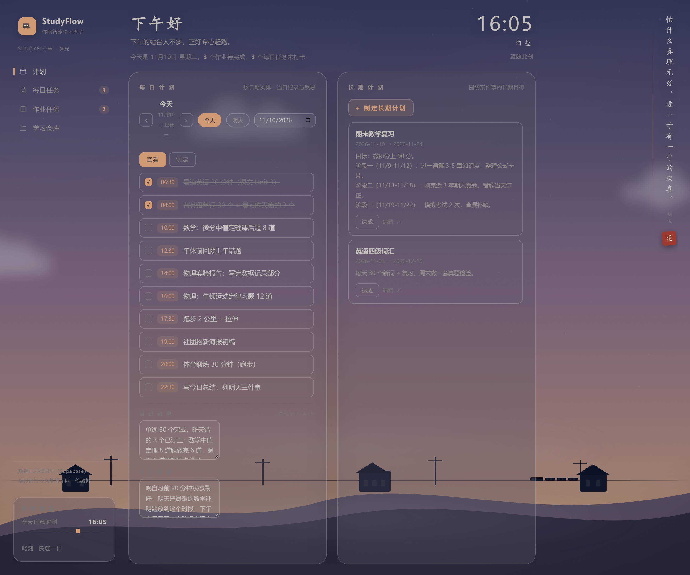 | 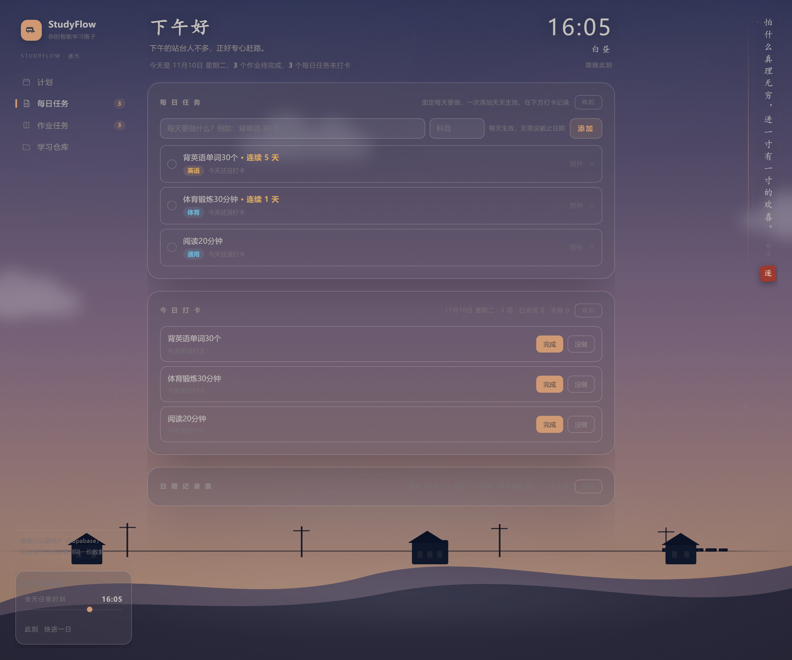 |

| 展开日期记录表 | 打卡反思表单（含「收起」） |
|---|---|
| 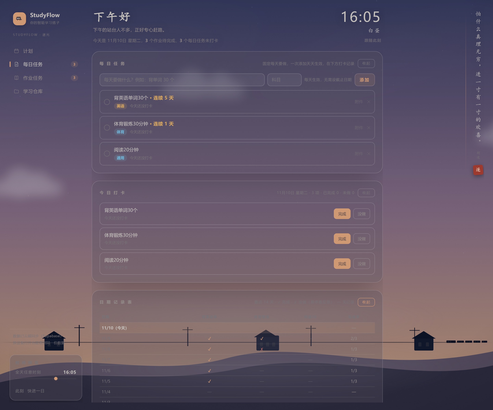 | 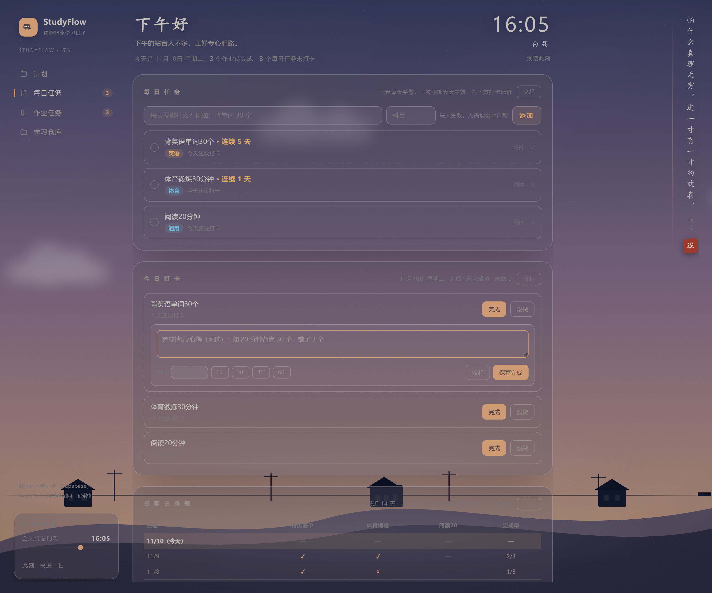 |

**各时段**：[黎明](screenshots/v1.3-dawn.png) · [白昼](screenshots/v1.3-day.png) · [黄昏](screenshots/v1.3-dusk.png) · [夜晚](screenshots/v1.3-night.png)

---

## v1.4 — 今日任务双组成 · 今日描述 · 长期计划反思 · 我的足迹

**动机**：实际使用进一步暴露三个需求——①"每日任务"名不副实：里面只有打卡任务，今天的计划散落在计划页；②制定计划时想写一段计划日志（今天是什么主题、想达成什么状态），事后则是记录与反思；③长期计划达成是一次里程碑，应该有地方写达成感言；④需要一个按日期归档的"日记本"，把每天的计划、反思、打卡、达成的长期计划串成时间线。

**改动**：
- **今日任务专栏重组**：导航「每日任务」更名「今日任务」，由两张卡组成——**打卡任务**（原每日任务，添加后每天固定）+ **计划任务**（当天计划，来自计划页，勾选完成与计划页实时联动，空时有「去计划页制定」引导）
- **今日描述（计划日志）**：`DayNote` 新增 `planNote` 字段——制定模式顶部可写今日主题/寄语（失焦自动保存）；查看模式以引文样式只读呈现；与当日记录、反思共存于同一天一条记录
- **长期计划达成反思**：`PlanItem` 新增 `reflection`（达成感言）与 `completedAt`（达成时间，取消达成时清除）；已达成条目显示「写反思/编辑反思」按钮与楷体引文呈现
- **我的足迹专栏**（新导航）：按日期倒序的只读时间线——每天的今日描述、当日计划与完成状态、打卡记录（✓/✗ + 用时）、当日记录与反思、当天达成的长期计划（含反思）；今天与昨天默认展开，更早默认折叠；未来日期不算足迹
- **云端同步**：`day_notes` 加 `plan_note` 列、`plans` 加 `reflection`/`completed_at` 列（`supabase-setup.sql` 幂等补列）；旧表缺新列时自动降级同步其余字段，重跑 SQL 后自动恢复全量

| 计划页（今日描述只读 + 达成反思） | 制定模式（今日描述编辑框） |
|---|---|
| 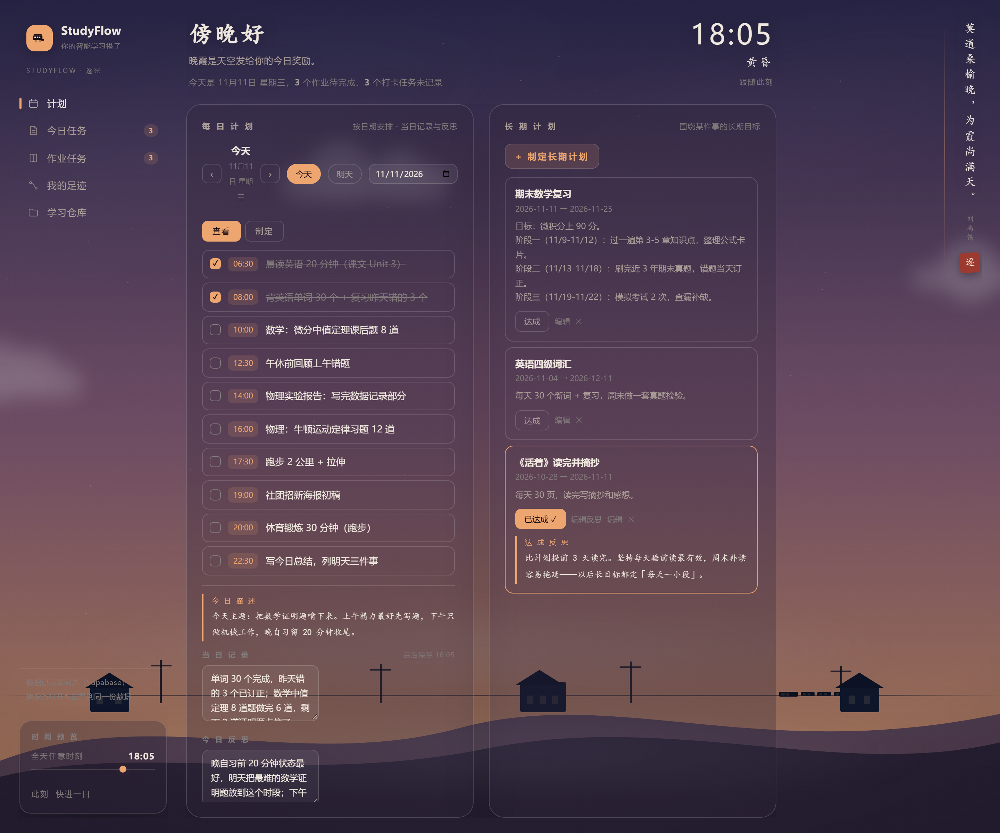 | 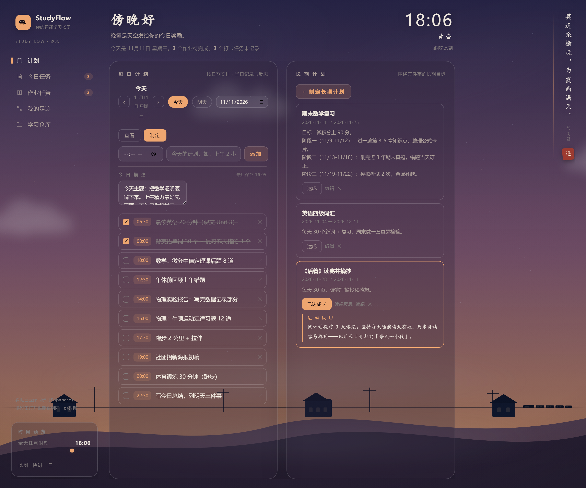 |

| 今日任务（计划任务 + 打卡任务） | 我的足迹（按日期时间线） |
|---|---|
| 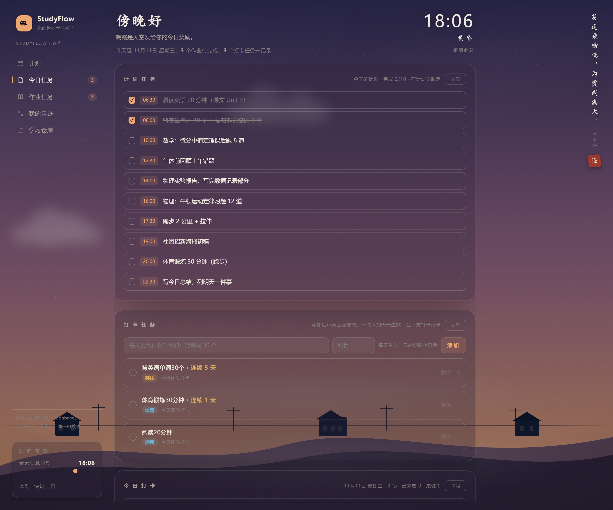 | 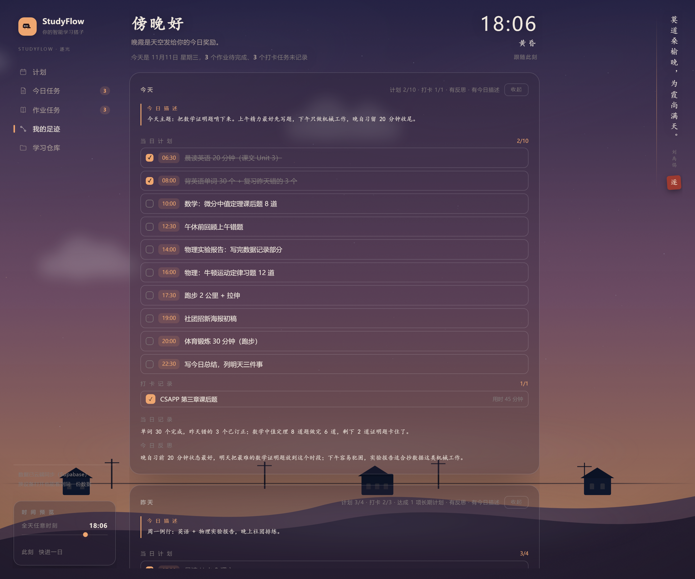 |

**各时段**：[黎明](screenshots/v1.4-dawn.png) · [白昼](screenshots/v1.4-day.png) · [黄昏](screenshots/v1.4-dusk.png) · [夜晚](screenshots/v1.4-night.png)

---

## 技术栈

- Next.js 16（App Router + Turbopack + Cache Components）
- React 19 + TypeScript
- Tailwind CSS 4
- 数据持久化：localStorage 秒开 + Supabase 云端同步（v0.7 起，未配置时自动退化为纯本地）

## 本地运行

```bash
npm install
npm run dev
# 打开 http://localhost:3000
```
