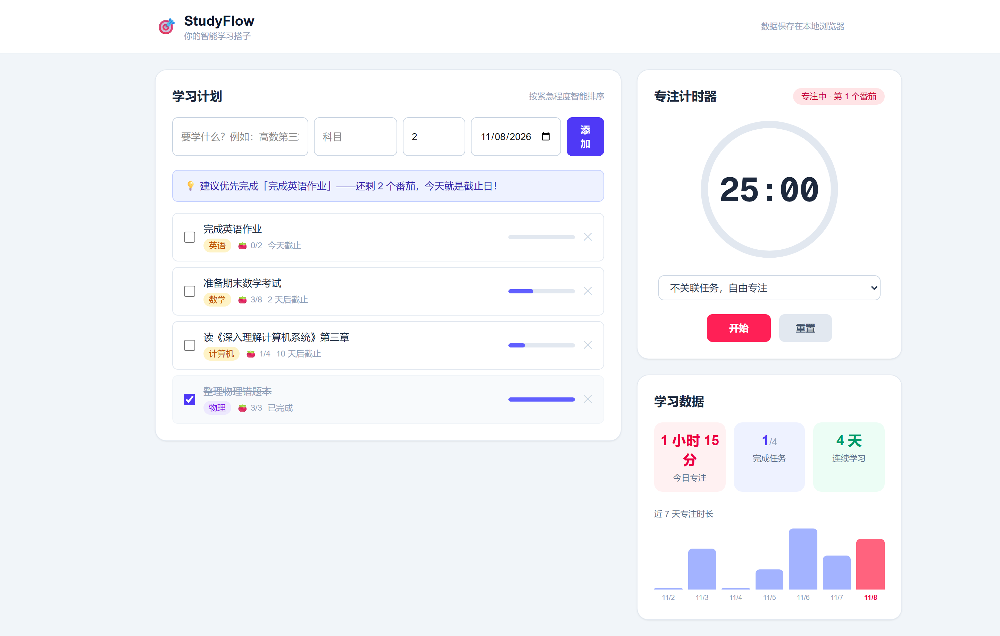
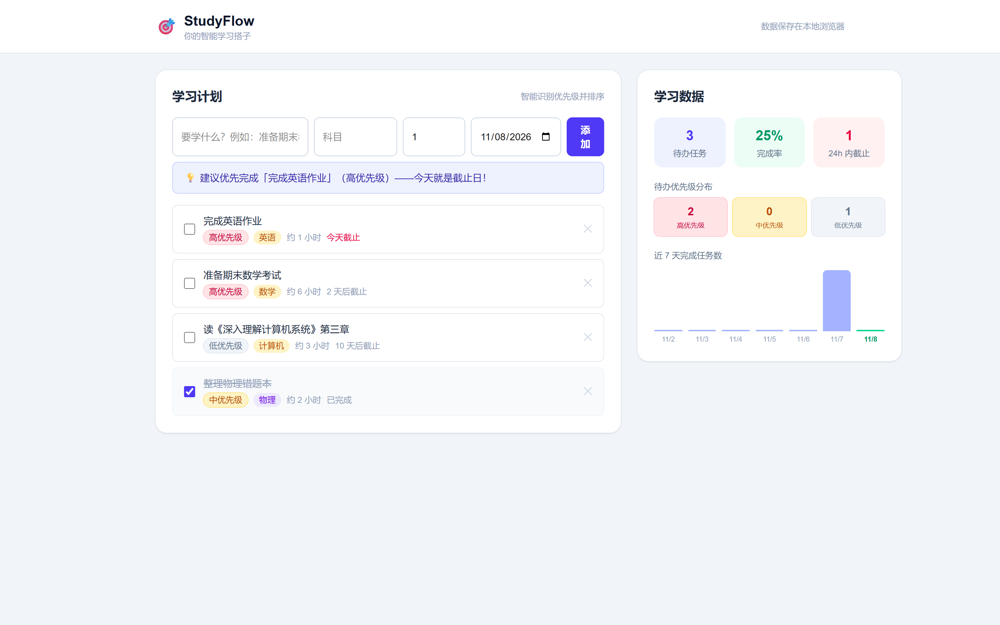
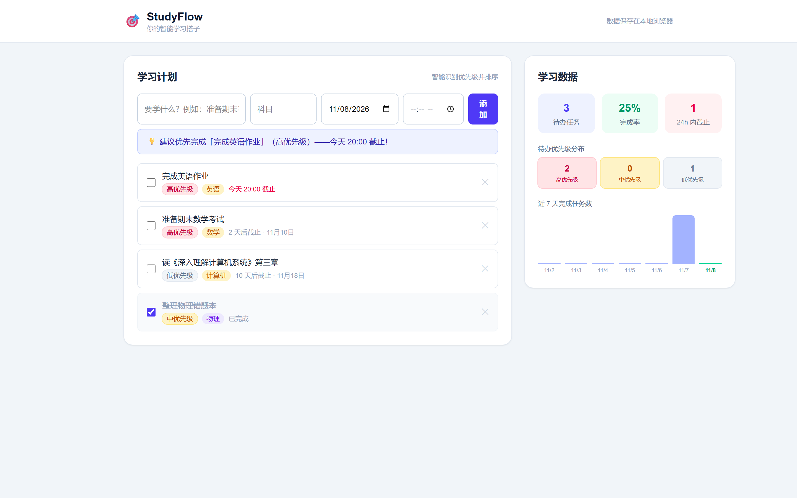
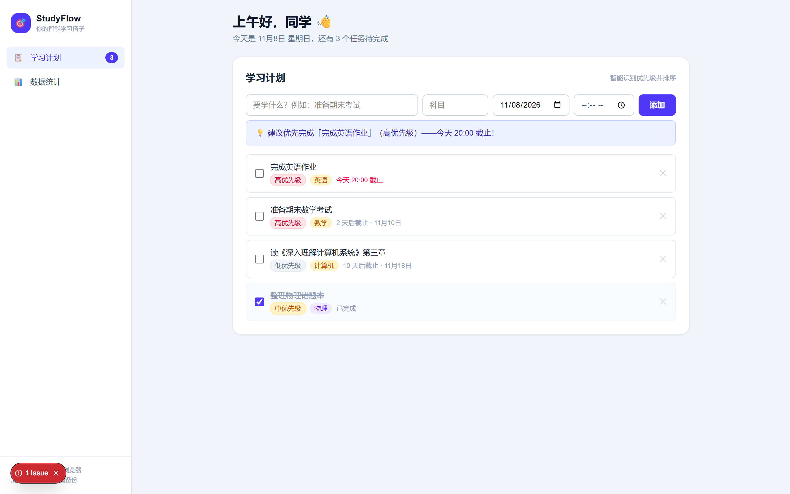
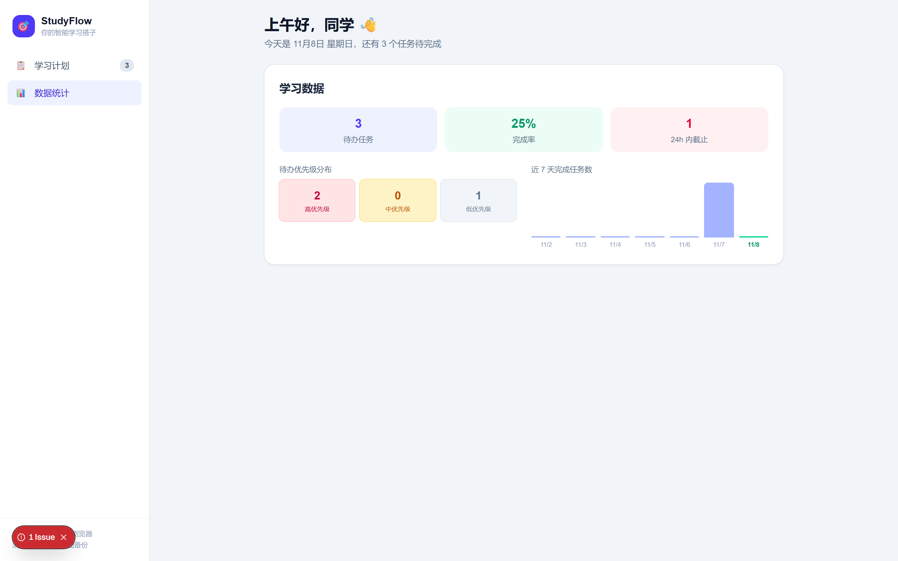
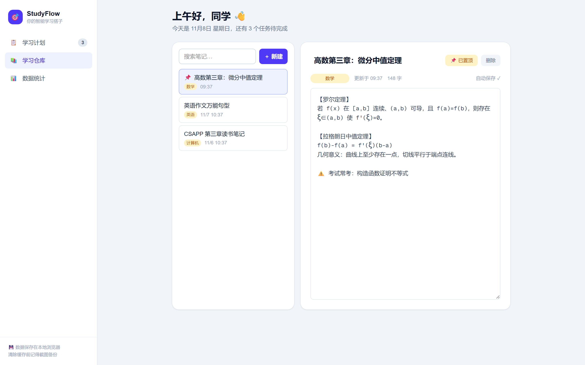
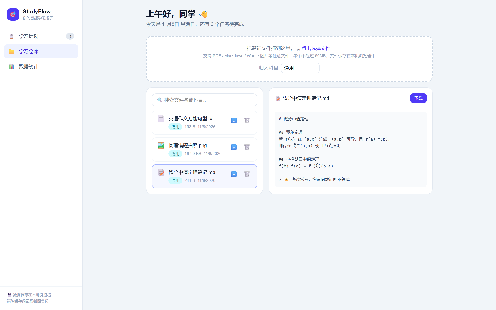
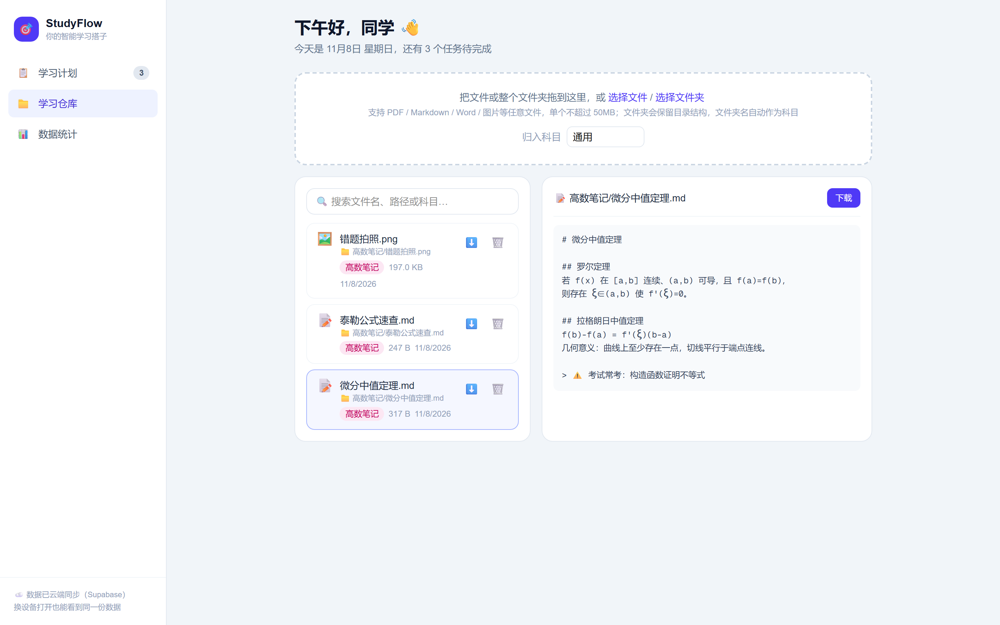
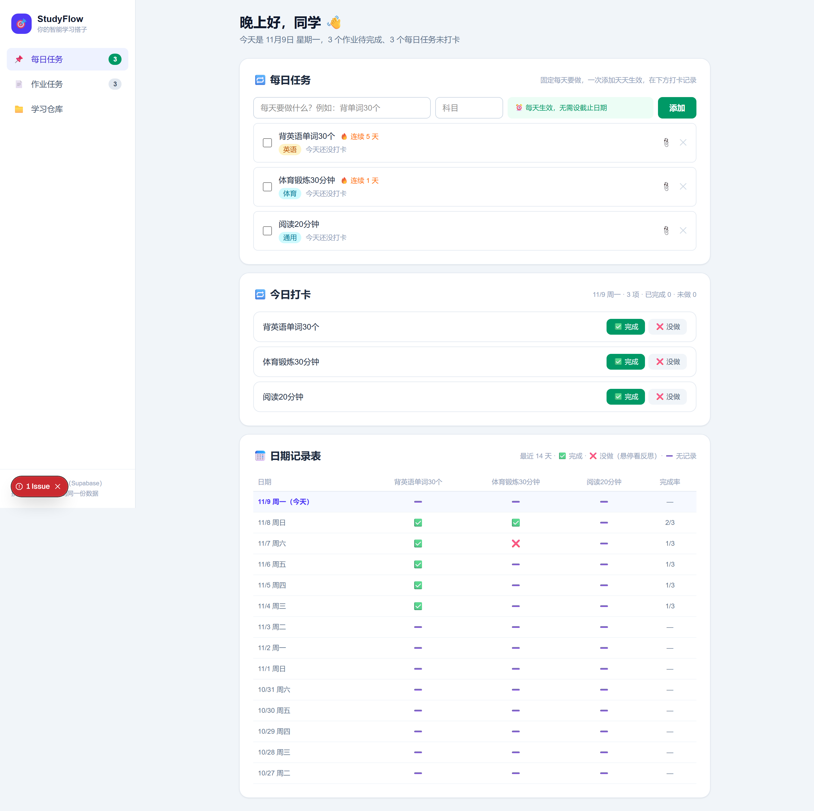
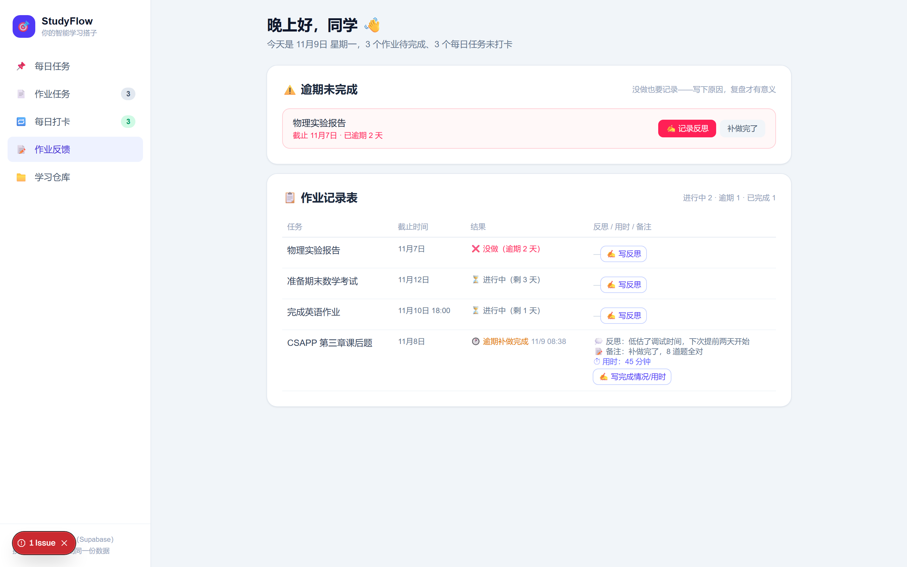

# StudyFlow 开发日志

> 校园黑客松作品 —— 智能学习辅助网站
> 记录每一次改动的动机、内容与思考。每个版本对应一个 git tag，可随时 `git checkout v0.x` 回看。

## 版本总览

| 版本 | 主题 | 截图 |
|------|------|------|
| v0.1 | MVP 初版：学习计划 + 番茄钟 + 专注统计 | [查看](screenshots/v0.1-mvp.png) |
| v0.2 | 移除番茄钟，新增智能优先级识别 | [查看](screenshots/v0.2-priority.png) |
| v0.3 | 移除预计工作量，截止时间精确到分 | [查看](screenshots/v0.3-deadline-time.png) |
| v0.4 | UI 改版：侧边栏仪表盘 | [计划视图](screenshots/v0.4-dashboard-plan.png) · [统计视图](screenshots/v0.4-dashboard-stats.png) |
| v0.5 | 新增学习仓库（笔记模块） | [计划视图](screenshots/v0.5-plan.png) · [笔记视图](screenshots/v0.5-notes.png) |
| v0.6 | 学习仓库重做：改为文件仓库（上传/预览/下载） | [计划视图](screenshots/v0.6-plan.png) · [仓库视图](screenshots/v0.6-repo.png) |
| v0.7 | 接入 Supabase 云端后端（任务/文件云同步） | [计划视图](screenshots/v0.7-plan.png) · [仓库视图](screenshots/v0.7-repo.png) |
| v0.8 | 任务分类 + 打卡反馈 + 日期记录表 + 任务附件 + 反思/用时 | [每日任务（含打卡）](screenshots/v0.8-daily.png) · [作业任务](screenshots/v0.8-plan-homework.png) |

---

## v0.1 — MVP 初版

**目标**：一个人参赛，先跑通最小闭环：定计划 → 专注执行 → 看数据反馈。

**功能**：
- 任务管理：标题 / 科目 / 预计番茄数 / 截止日期，完成打勾、删除、进度条
- 按「剩余天数 ÷ 剩余番茄数」计算紧急程度，智能排序 + 今日优先建议
- 番茄钟：25 分钟专注 + 5 分钟休息循环，环形进度动画，可关联任务
- 统计面板：今日专注时长、完成任务数、连续学习天数、近 7 天专注时长柱状图
- localStorage 本地持久化，无需后端



---

## v0.2 — 移除番茄钟，新增智能优先级识别

**动机**：番茄钟与任务计划耦合度低，且偏离"智能学习计划"的核心定位；评委更容易被"智能"打动，于是砍掉番茄钟，换上更有辨识度的功能——自动识别任务重要程度（低/中/高）。

**改动**：
- 删除番茄钟模块及专注数据模型
- 新增优先级引擎 `src/lib/priority.ts`：截止日远近 + 关键词（考试/论文/答辩等）+ 预计工作量，三信号加权打分
- 任务标注 高/中/低 优先级标签（红/黄/灰），列表按优先级 → 截止日排序
- 添加任务时实时预览识别结果
- 统计面板改为任务维度：待办数 / 完成率 / 24h 内截止 / 优先级分布 / 近 7 天完成任务数
- 旧 localStorage 数据自动迁移（normalize 函数兜底）



---

## v0.3 — 移除预计工作量，截止时间精确到分

**动机**：添加任务的表单字段太多会降低录入意愿；"预计几小时"对用户是负担。同时真实的截止日期常常有具体时刻（如"今晚 8 点交作业"）。

**改动**：
- 删除"预计小时数"输入框及数据字段
- 新增可选截止时刻（time 输入），不填则只显示到日
- 展示规则：填了时刻 → `3 天后截止 · 11月12日 14:30`；没填 → `3 天后截止 · 11月12日`
- 优先级识别相应简化为两信号（截止日 + 关键词）



---

## v0.4 — UI 改版：侧边栏仪表盘

**动机**：单页堆叠布局像"作业页面"，黑客松演示需要"完整产品"的第一印象。

**改动**：
- 新增左侧边栏：品牌区 + 导航（学习计划 / 数据统计）+ 待办数角标
- 动态页头：按时段问候 + 今日日期 + 待办任务播报
- 统计视图宽屏适配：优先级分布与趋势图左右并排
- 移动端降级为顶部品牌栏 + 胶囊标签切换

**Bug 修复（同版本内）**：开启 Cache Components 后，`new Date()` 在预渲染阶段执行会报错（`unstable value in Client Component`）。修复：当前时间的读取移到客户端水合（hydrated）之后再执行。




---

## v0.5 — 新增学习仓库（笔记模块）

**动机**：学习计划解决"做什么"，但学习过程中产生的笔记、知识点总结没地方放。"计划 + 仓库"构成完整的学习闭环。

**改动**：
- 新增「学习仓库」视图（侧边栏第三个入口 📚）
- 笔记增删改查：标题 / 科目分类 / 多行正文，输入即自动保存（无需手动点保存）
- 全文搜索（标题 / 正文 / 科目）+ 置顶 + 按更新时间倒序
- 双栏布局：左侧笔记列表（科目标签、更新时间），右侧编辑器（字数统计、置顶、删除）
- 数据模型新增 `Note`，localStorage 旧数据自动迁移兼容



---

## v0.6 — 学习仓库重做：改为文件仓库

**动机**：v0.5 上线后收到真实反馈——用户要的不是在网页里手写笔记，而是一个**仓库**：把自己已有的笔记文件（PDF、Markdown、错题照片等）存进去，随取随用。这是一次典型的"按用户反馈推翻重做"。

**改动**：
- 移除 v0.5 的网页笔记编辑器，学习仓库改为**文件仓库**
- 支持拖拽 / 点选上传任意文件（单个 ≤50MB），上传时可归入科目
- **支持上传整个文件夹**（拖拽或「选择文件夹」），保留目录结构展示，文件夹名自动作为科目
- 在线预览：图片、Markdown/纯文本、PDF；其他类型（Word 等）可下载后查看
- 文件列表：类型图标、目录路径、科目分类（点击可改）、大小、日期、搜索（含路径）、下载、删除
- 存储方案：文件内容（Blob）存 **IndexedDB**（localStorage 存不下大文件），元信息仍走 localStorage；v0.5 的 notes 旧数据自动忽略



---

## v0.7 — 接入 Supabase 云端后端

**动机**：v0.6 的文件存在浏览器 IndexedDB，清缓存/换设备就丢。黑客松演示可能换电脑，需要真正的"记忆"——云端持久化。

**改动**：
- 接入 **Supabase**（PostgreSQL + Storage）：任务和文件元数据存数据库表，文件内容存 Storage 存储桶
- 同步策略：**本地优先**——localStorage 秒开首屏，后台拉取云端数据（云端为准）；每次变更同时写本地和云端，断网也能用
- 首次接入自动迁移：本地旧数据（任务、v0.6 的文件）自动上传云端，用户无感
- 并发防护：云端写操作串行队列化（upsert 与 delete 交错会互相覆盖，开发期实测踩过这个坑）
- 降级设计：未配置 Supabase 环境变量时自动退化为纯本地模式
- 建表脚本沉淀为 [supabase-setup.sql](supabase-setup.sql)，一键复现后端

**架构**：

```
浏览器 React 状态
   ├─ localStorage（首屏缓存，秒开）
   └─ Supabase（云端真实来源）
        ├─ tasks / repo_files 表（元数据）
        └─ repo-files 存储桶（文件内容）
```



---

## v0.8 — 任务分类 + 打卡反馈 + 日期记录表 + 任务附件

**动机**：用户真实场景——有些任务是"每天固定要做"的（背单词、锻炼），不该每天重新添加；而作业类任务是按次布置的。并且"做与没做"都要留痕，没做的要写反思原因，才能真正复盘。另外收到作业时，题目内容、提交网址、附件文件应该跟着任务走，不用到处翻。

**改动**：
- **任务分类**：🔁 每日任务（一次添加天天生效，无需截止日期）＋ 📝 作业任务（按截止日期）
- **管理分栏（迭代）**：按用户反馈，两类任务在侧边栏彻底分开——「每日任务」「作业任务」各自独立页面，各有添加表单与列表，不再混在一栏
- **每日任务与打卡合并一栏（迭代）**：按用户反馈，每日任务的管理与打卡放进同一页面——上方添加/列表，中间「今日打卡」（一键 ✅完成 / ❌没做，反思+用时表单），下方 14 天日期记录表，连续打卡 🔥
- **移除作业反馈页（迭代）**：用户决定先下线，作业反思功能代码保留在 git 历史
- **任务附件**：任务上可挂三类附件——📝 作业内容（直接粘贴题目文本）、🔗 网址（一键打开）、📄 文件（传 Supabase Storage），任务行显示附件数角标
- **数据模型**：新增 `checkins` 表（task_id + date 唯一，status=done/missed，reason 反思）；tasks 表新增 `type`、`attachments`(jsonb) 列，旧数据自动迁移
- **完成也可写反思（迭代）**：按用户反馈，完成打卡/作业完成后同样能补记"完成情况/心得"备注；反思/备注/用时统一放进醒目的表单卡片，不再藏在小按钮里
- **用户自填用时（迭代）**：打卡记录新增"用时"字段（分钟，自填，带 15/30/45/60 快捷值），打卡行、日期表悬停、作业记录表均展示
- **移除数据统计页（迭代）**：用户决定先下线统计功能，后续重新设计；Sidebar 精简为 4 个入口（StatsPanel 代码仍在 git 历史中可找回）




---

## 技术栈

- Next.js 16（App Router + Turbopack + Cache Components）
- React 19 + TypeScript
- Tailwind CSS 4
- 数据持久化：localStorage（无后端，MVP 阶段刻意为之）

## 本地运行

```bash
npm install
npm run dev
# 打开 http://localhost:3000
```
